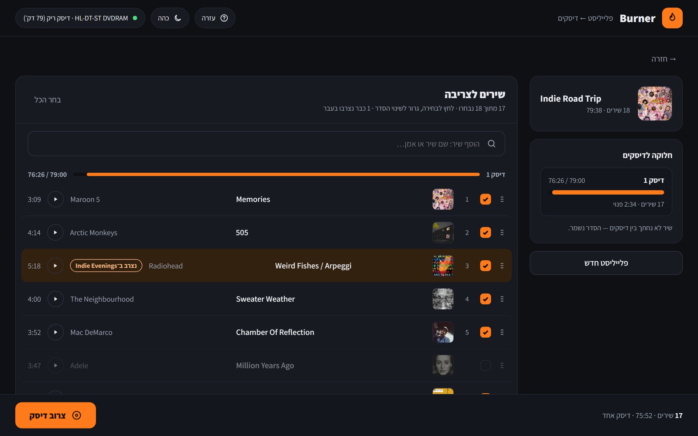
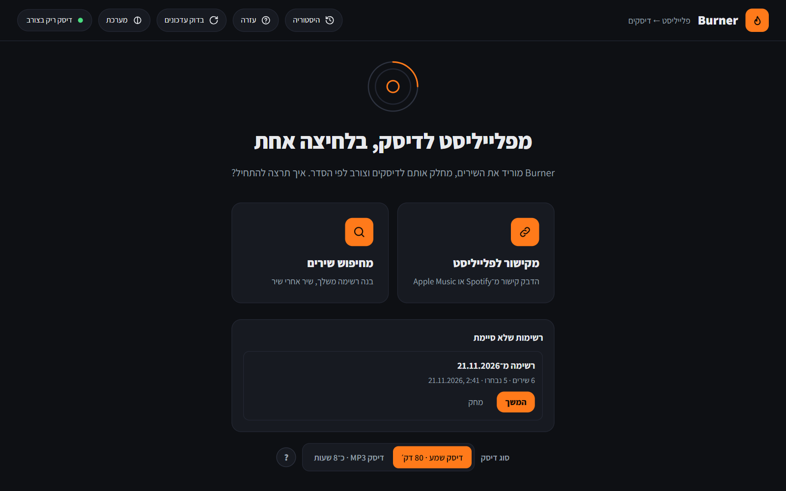
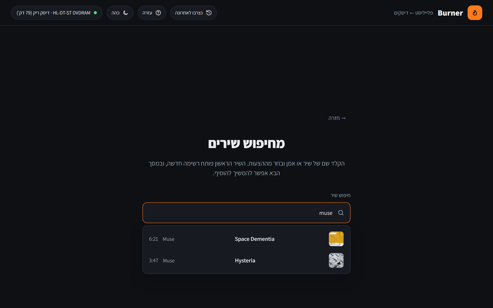
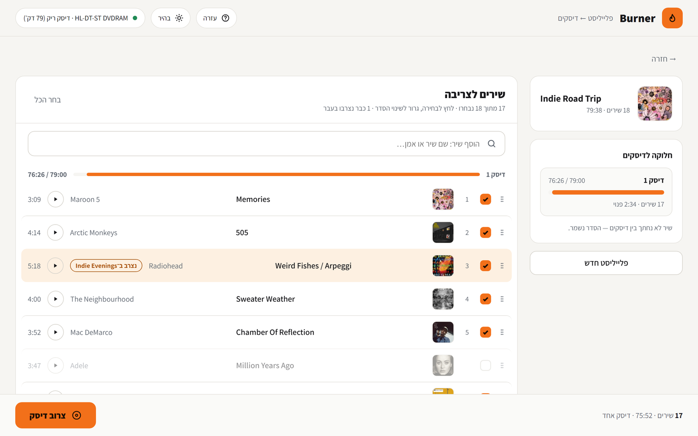
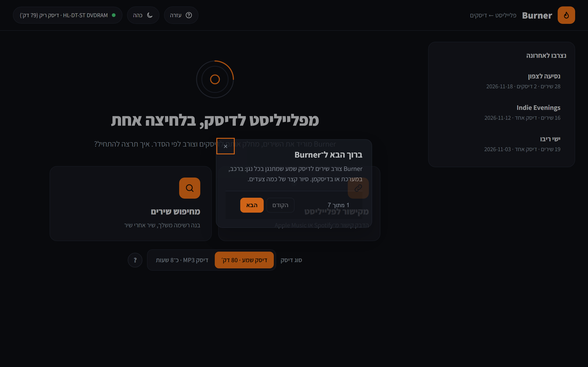

<div dir="rtl">

<p align="center">
  
</p>

<h1 align="center">Burner</h1>

<p align="center">
  <b>מפלייליסט לדיסק, בלחיצה אחת.</b><br>
  Burner לוקח פלייליסט מ־Spotify או Apple Music, או רשימה שבנית בחיפוש,<br>
  מוריד את השירים וצורב אותם לדיסק שמע שמתנגן בכל נגן: ברכב, במערכת או בדיסקמן.
</p>

<p align="center">
  <a href="https://github.com/yishai946/Burn/releases/latest/download/Burner-Setup.exe"></a>
</p>

<p align="center">
  <a href="https://github.com/yishai946/Burn/releases/latest"></a>
  
</p>

<p align="center">
  
</p>

## Burner בפעולה

<p align="center">
  <a href="burner_demo.mp4"></a>
  <br>
  <sub>תצוגה מואצת. <a href="burner_demo.mp4">▶ לסרטון המלא (MP4, דקה ו־12 שניות)</a></sub>
</p>

## מה יש בו

- **שתי דרכים להתחיל** – הדבקת קישור לפלייליסט ציבורי מ־Spotify או Apple Music, או בניית רשימה מחיפוש שירים עם הצעות בזמן הקלדה.
- **חלוקה חכמה לדיסקים** – השירים מתחלקים לדיסקים של 80 דקות לפי הסדר, בלי לחתוך שיר באמצע. אם הדיסק האחרון כמעט ריק, Burner אומר כמה דקות לבטל כדי לחסוך דיסק.
- **סידור חופשי** – לחיצה מסמנת או מבטלת שיר, גרירה משנה את הסדר, והחלוקה מתעדכנת מיד.
- **תצוגה מקדימה** – קטע של 30 שניות מכל שיר, ישר מהרשימה.
- **היסטוריית צריבות** – שיר שכבר צרבת מסומן בכתום, עם שם הפלייליסט שבו נצרב.
- **דיסק שמע אמיתי** – Audio CD בפורמט 44.1kHz, שמתנגן גם בנגנים ישנים.
- **מצב בהיר וכהה**, סיור מודרך בפתיחה הראשונה, ועדכונים אוטומטיים.

## התקנה

1. מורידים את [`Burner-Setup.exe`](https://github.com/yishai946/Burn/releases/latest/download/Burner-Setup.exe) ומריצים.
2. Windows עשוי להציג **"Windows protected your PC"**, כי הקובץ לא חתום דיגיטלית. לוחצים **More info** ואז **Run anyway**.
3. בוחרים אם להוסיף קיצור דרך לשולחן העבודה, ו־Burner נפתח בסוף ההתקנה.

ההתקנה לא דורשת הרשאות מנהל. הכול כלול בה, כולל yt-dlp ו־ffmpeg, ואין צורך להתקין שום דבר נוסף. אפשר להסיר את Burner מ־**הגדרות ← אפליקציות** כמו כל תוכנה.

## איך משתמשים

<table>
  <tr>
    <td width="50%"></td>
    <td width="50%"></td>
  </tr>
  <tr>
    <td><b>1. בוחרים איך להתחיל.</b> קישור לפלייליסט, או חיפוש שירים. למטה מופיעים פלייליסטים שנצרבו לאחרונה.</td>
    <td><b>2. בונים את הרשימה.</b> בחיפוש, כל שיר שבוחרים מההצעות נכנס לרשימה. אפשר להמשיך להוסיף גם במסך הבא.</td>
  </tr>
  <tr>
    <td></td>
    <td></td>
  </tr>
  <tr>
    <td><b>3. מסדרים וצורבים.</b> מסמנים שירים, גוררים לשינוי סדר, מכניסים דיסק CD-R ריק ולוחצים <b>צרוב</b>. אם יש כמה דיסקים, Burner יבקש להכניס כל אחד בתורו.</td>
    <td><b>לא בטוחים?</b> בפתיחה הראשונה יש סיור מודרך, ואפשר להפעיל אותו שוב בכל רגע מכפתור <b>עזרה</b>.</td>
  </tr>
</table>

## עדכונים

כשיוצאת גרסה חדשה, Burner מציג בפתיחה פס **"גרסה חדשה זמינה"**. לחיצה על **עדכן עכשיו** מורידה ומתקינה את העדכון ופותחת את Burner מחדש. ההיסטוריה וההגדרות נשמרות.

## דרישות

- Windows 10 או 11 (64 ביט)
- צורב CD ודיסקי CD-R ריקים
- חיבור לאינטרנט, להורדת השירים
- Microsoft Edge WebView2 – קיים מראש ב־Windows 11. אם הוא חסר, ההתקנה תציע להוריד אותו.

## פרטיות

היסטוריית הצריבות נשמרת רק במחשב שלך, ב־`%APPDATA%\Burner`. Burner לא שולח שום מידע עליך לשום מקום.

> Burner נועד לשימוש אישי. אחריותך לוודא שיש לך זכות להוריד ולצרוב את השירים.

---

## למפתחים

<details>
<summary><b>הרצה מהקוד, בנייה ופרסום גרסה</b></summary>

<br>

**איך זה בנוי**

| קובץ | תפקיד |
|---|---|
| `app.py` | החלון (pywebview), החיבור לממשק, הצריבה ברקע ובדיקת העדכונים |
| `core.py` | קריאת פלייליסטים, חיפוש שירים, חלוקה לדיסקים, הורדה (yt-dlp), צריבה (IMAPI2 של Windows) והיסטוריה |
| `index.html` | כל הממשק: HTML, CSS ו־JavaScript בקובץ אחד |
| `vendor/` | [Driver.js](https://driverjs.com) לסיור המודרך (MIT) |
| `installer/burner.iss` | סקריפט ההתקנה (Inno Setup) |
| `build.bat` | בונה את `Burner.exe` ואת קובץ ההתקנה, ואופציונלית מפרסם גרסה |

**הרצה מהקוד**

```powershell
pip install -r requirements.txt
python app.py
```

צריך גם `ffmpeg` ב־PATH, למשל `winget install Gyan.FFmpeg`. השתמשו ב־Python הרגיל מ־python.org ולא בגרסה מ־Microsoft Store, שמציגה בשורת המשימות את האייקון של Python.

**בנייה**

```powershell
build.bat
```

הבנייה דורשת [Inno Setup 6](https://jrsoftware.org/isinfo.php). התוצאה היא `dist\Burner-Setup.exe`. במהלך הבנייה רצה בדיקה עצמית: חיפוש שיר, איתור ביוטיוב והורדה אמיתית עם ה־ffmpeg שבחבילה.

**פרסום גרסה**

1. מעלים את `VERSION` ב־`core.py`, למשל ל־`1.2.0`.
2. עושים push ל־`main`. ה־workflow ‏[`release.yml`](.github/workflows/release.yml) בונה את ההתקנה בשרתים של GitHub ומפרסם Release בשם `v1.2.0`. push שלא משנה את הגרסה לא מפרסם כלום.
3. מי שהתקין את Burner יקבל הצעה לעדכן בפתיחה הבאה.

אפשר גם לפרסם מהמחשב עם `build.bat release`, או להריץ את ה־workflow ידנית במצב **build only** כדי לבדוק בנייה בלי לפרסם.

</details>

</div>
